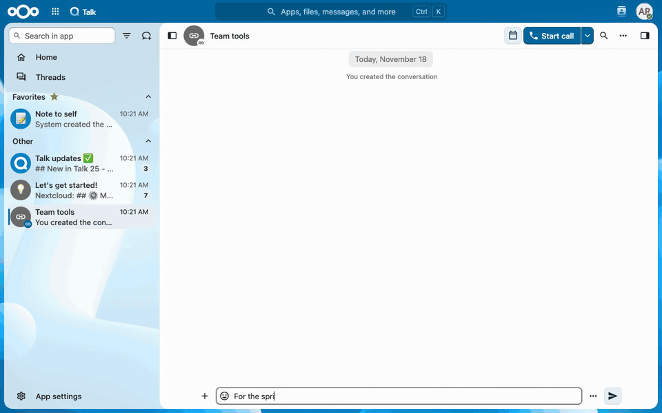

<!--
  - SPDX-FileCopyrightText: 2026 Oliver Anyanwu
  - SPDX-License-Identifier: AGPL-3.0-or-later
-->
# App Store Cards

[](https://github.com/oliv3rdrt/appstore_cards/actions/workflows/phpunit-sqlite.yml)
[](https://github.com/oliv3rdrt/appstore_cards/actions/workflows/playwright.yml)
[](https://github.com/oliv3rdrt/appstore_cards/actions/workflows/psalm-matrix.yml)
[](https://github.com/oliv3rdrt/appstore_cards/actions/workflows/reuse.yml)

Rich previews and search for Nextcloud App Store links.

Paste a link to an app from the [Nextcloud App Store](https://apps.nextcloud.com) into Talk, Text or any other app with link previews, and it becomes a card with the app's details. App Store apps can also be found from unified search and inserted with the Smart Picker.



Screenshots: [Talk](docs/screenshots/talk.png), [Text](docs/screenshots/text.png), [Smart Picker](docs/screenshots/smart-picker.png), [unified search](docs/screenshots/unified-search.png), [dark theme](docs/screenshots/talk-dark.png) and [admin settings](docs/screenshots/admin-settings.png).

## Features

- **Link previews:** a card with the app's screenshot, name, summary, latest version, supported Nextcloud versions, rating and categories. It works wherever Nextcloud shows link previews, including on public share pages.
- **Unified search:** App Store apps appear under "More from App Store".
- **Smart Picker:** choose "App Store apps" in the Smart Picker, for example by typing `/` in Text, and insert a link to an app.
- **Privacy:** the server talks to the App Store, not the people viewing a card. Admins can turn screenshots off.
- **Accessibility:** cards work with a keyboard and screen readers, and follow the user's theme.

## Requirements

- Nextcloud 35
- PHP 8.3 or later
- Background jobs, ideally run by cron, so that the catalogue stays up to date
- Outgoing HTTPS access to apps.nextcloud.com (or the App Store set in `appstoreurl`) and, for screenshots, usercontent.apps.nextcloud.com

## Installation

Install App Store Cards from the Integration category of the Apps page, or with:

```bash
occ app:install appstore_cards
```

The app fills its catalogue at the next cron run. To fill it straight away:

```bash
occ appstore_cards:refresh
```

## Configuration

Administration settings > Additional settings > App Store Cards has one switch, **Show screenshots**, which is on by default. It also shows when the catalogue was last updated.

The catalogue comes from the App Store set in Nextcloud's `appstoreurl`. When `appstoreenabled` is `false`, the app stops updating the catalogue.

## Privacy

What leaves the server:

- **Once a day**, a request for the catalogue of apps for this Nextcloud version. It contains the version number and a cache tag. No user data is sent.
- **When a screenshot is first shown**, a request for that image from the App Store's image host. It says nothing about who is viewing it. With screenshots turned off, no images are downloaded.

Browsers only ever talk to your Nextcloud server. The app stores the public catalogue in its own table and a copy of each screenshot shown, up to 100 MB in total. It stores nothing about users.

Disabling the app empties the catalogue and the screenshot cache. Removing it leaves only an empty table, the screenshot switch and Nextcloud's own record of the app.

## Development

- [Architecture](docs/architecture.md): how the app is built and why.
- [Architecture decision records](docs/adr): the decisions behind it.
- [Testing](docs/testing.md): how to run each test suite.
- [Contributing](CONTRIBUTING.md): how to set up, check and submit a change.
- [Release checklist](docs/release-checklist.md): how a version reaches the App Store.

To report a security issue, see [SECURITY.md](SECURITY.md).

## Licence

AGPL-3.0-or-later. See [LICENSE](LICENSE).
