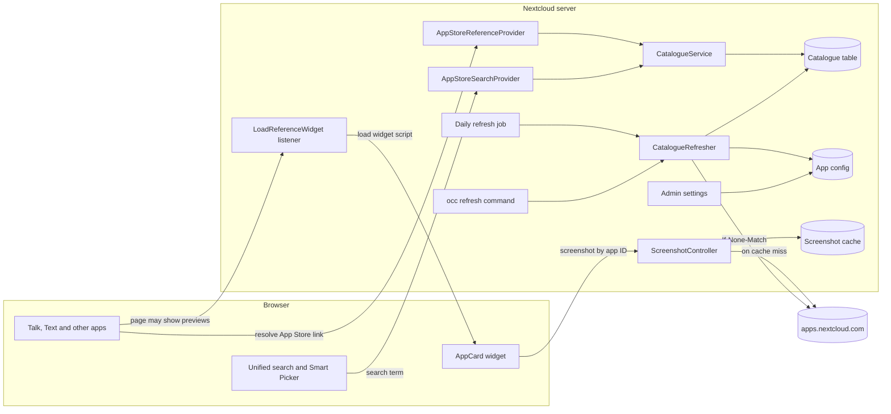

<!--
  - SPDX-FileCopyrightText: 2026 Oliver Anyanwu
  - SPDX-License-Identifier: AGPL-3.0-or-later
-->
# Architecture

App Store Cards keeps a slim local copy of the Nextcloud App Store catalogue and uses it to turn App Store links into rich cards, and to find apps from unified search and the Smart Picker. Every user-facing request is answered from the local copy. Only a daily background job and the screenshot cache talk to the App Store.

The decisions behind this design are recorded in [docs/adr](adr/).

## Overview

## Components

| Component | Nextcloud API | Responsibility |
|---|---|---|
| `AppStoreReferenceProvider` | `ADiscoverableReferenceProvider`, `ISearchableReferenceProvider`, `IPublicReferenceProvider` | Recognises App Store links and returns a reference with a title, description, image URL and a rich object for the widget. Registers the Smart Picker entry, which reuses the search provider. |
| `AppStoreSearchProvider` | `OCP\Search\IProvider` | Searches the local catalogue with paginated results. It is not an external provider, because search terms never leave the server. |
| `LoadReferenceWidget` | `RenderReferenceEvent` listener | Loads the widget script only on pages that may show previews. |
| AppCard widget | `registerWidget()` from `@nextcloud/vue` | Renders the card in Vue 3 from the rich object. |
| `ScreenshotController` | `Controller` returning an image | Serves an app's screenshot by app ID, for logged-in users and public share visitors, with rate limits. |
| `CatalogueService` | `IDBConnection` | Reads apps by ID and searches by name and summary. |
| `CatalogueRefresher` | `IClientService`, `IAppConfig` | Downloads the catalogue with the stored ETag, parses it and updates the table. |
| Refresh job | `TimedJob` | Runs the refresher every 24 hours, time-insensitive and never in parallel. |
| Refresh command | `#[AsCommand]` | Runs the refresher on demand with `occ`. |
| Admin settings | `IDeclarativeSettingsForm` | Admin-only options, stored in app config. |
| Uninstall step | `IRepairStep` | Removes the table's data, the app config and the screenshot cache. |

## Main flows

**Refresh.** The job asks `apps.nextcloud.com/api/v1/platform/<x.y.z>/apps.json` for the instance's own version, sending the stored ETag.
- A `304 Not Modified` ends the run.
- A `200` replaces the table in one transaction and stores the new ETag and time.
- An error keeps the existing data and logs a warning.
- The job skips the request when `appstoreenabled` is false, and uses `appstoreurl` when it is set.

**Link preview.** Talk, Text and other apps send links to Nextcloud's reference API.
- The provider matches `https://apps.nextcloud.com/apps/<id>`, with an optional trailing slash, query or fragment, then looks the ID up in the table.
- Unknown IDs fall back to Nextcloud's generic preview.
- Clients without the widget still get the title, description and image.

**Search and Smart Picker.** Unified search calls the search provider with the term and a cursor. The Smart Picker shows the same results and inserts the app's App Store link.

**Screenshot.** The widget requests the screenshot route with an app ID.
- The server looks the image URL up in the table, checks that the host is the App Store's image host, and serves the image from the cache.
- On a cache miss it fetches the image with a timeout and size limit first.

## Access and security

| Entry point | Who | Protection |
|---|---|---|
| Reference resolution | Logged-in users, public share visitors | Nextcloud's reference API. Only catalogue data, which is public. |
| Unified search and Smart Picker | Logged-in users | Nextcloud's search API |
| Screenshot route | Logged-in users, public share visitors | `#[NoAdminRequired]`, `#[PublicPage]`, `#[UserRateLimit]`, `#[AnonRateLimit]`. App IDs only, never URLs. |
| Admin settings | Admins | Declarative settings in the admin section |
| Refresh command | Server operators | `occ` access |

Output is escaped by Vue templates, and the content security policy is not relaxed.

## What leaves the server

- **The daily catalogue request** to the App Store (or `appstoreurl`). It contains the instance's Nextcloud version in the URL and the stored ETag. No user data is sent.
- **Screenshot requests** to the App Store's image host, made by the server when an image is not yet cached. They contain no information about who is viewing.

Nothing else leaves the server. Browsers only talk to the Nextcloud instance.

## Performance

- Previews and search are single indexed queries on a table of about 550 rows.
- Search results are paginated with a cursor.
- The widget script loads only on pages that may show previews.
- The screenshot cache has a total size limit, and images are served with long cache headers.

## Upgrades and removal

- The schema is created and changed by migrations, which must work for upgrades and downgrades.
- `occ app:remove` runs the uninstall step. `--keep-data` keeps the data.

## Open questions for implementation

- The exact columns and indexes of the catalogue table, and whether to use `QBMapper` or Nextcloud 35's typed query builder or ORM.
- The fields of the admin settings form.
- The size limits for single screenshots and for the whole cache.
